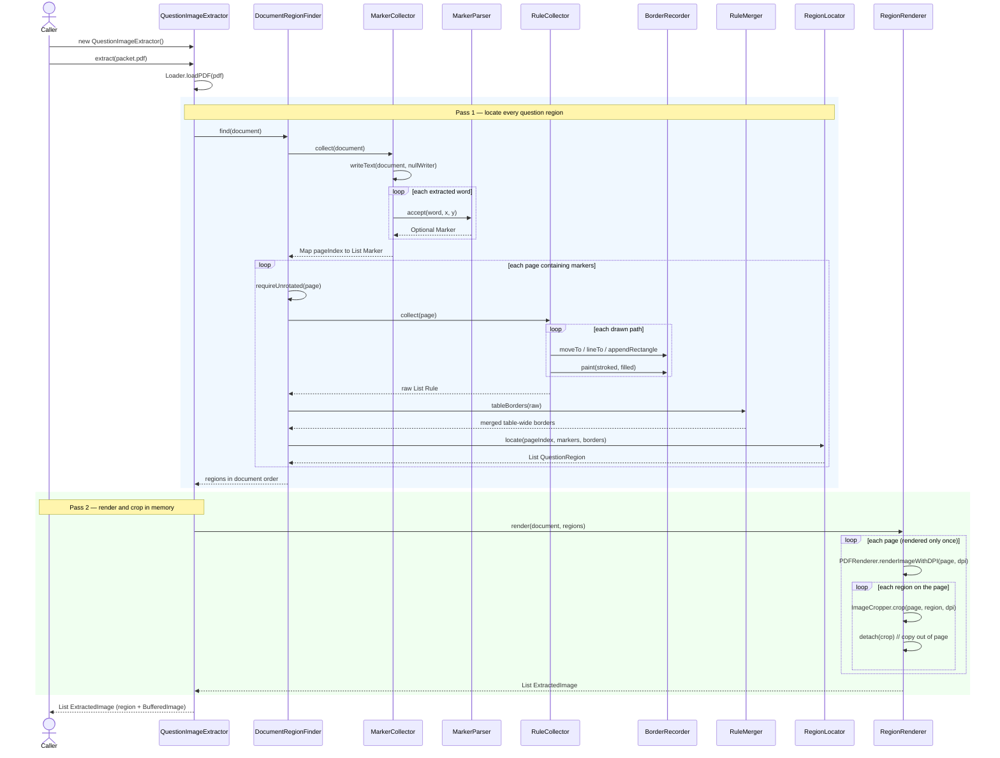
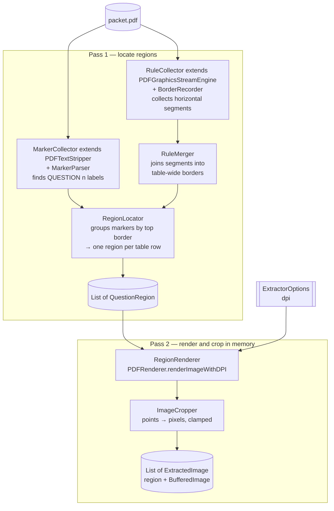

# UML — UIL Extractor (`uil-extractor`)

Package `uil.extractor` is a **library** that turns a multiple-choice contest packet PDF into one
in-memory image per question row (or per group of questions that share a table row).

Entry point: `new QuestionImageExtractor().extract(Path pdf)` returns a `List<ExtractedImage>`,
where each `ExtractedImage` pairs a `QuestionRegion` with a cropped `BufferedImage`. Nothing is
written to disk; callers decide how to store, display or post-process the images.

Dependency: Apache PDFBox (`PDDocument`, `PDFTextStripper`, `PDFGraphicsStreamEngine`, `PDFRenderer`).

Legend:

- `*--` composition (owns the field)
- `..>` dependency (uses transiently)
- `--|>` inheritance
- `$` static member, `<<record>>` Java record, `~` package-private / generic type delimiter

---

## 1. Class diagram

```mermaid
classDiagram
    direction TB

    class QuestionImageExtractor {
        -ExtractorOptions options
        +QuestionImageExtractor()
        +QuestionImageExtractor(ExtractorOptions options)
        +extract(Path pdf) List~ExtractedImage~
    }

    class DocumentRegionFinder {
        -DocumentRegionFinder()$
        +find(PDDocument document) List~QuestionRegion~$
    }

    class MarkerCollector {
        -Map~Integer,List~Marker~~ markersByPage
        -MarkerParser parser
        -int parserPageIndex
        -MarkerCollector()$
        +collect(PDDocument document) Map~Integer,List~Marker~~$
        #writeString(String text, List~TextPosition~ textPositions)
    }

    class MarkerParser {
        -Pattern KEYWORD$
        -Pattern NUMBER$
        -boolean awaitingNumber
        -double pendingX
        -double pendingY
        +accept(String word, double x, double y) Optional~Marker~
        -completeFrom(String word) Optional~Marker~
        -startFrom(String word, double x, double y) Optional~Marker~
    }

    class RuleCollector {
        -BorderRecorder recorder
        -RuleCollector(PDPage page)
        +collect(PDPage page) List~Rule~$
        +appendRectangle(Point2D p0, Point2D p1, Point2D p2, Point2D p3)
        +moveTo(float x, float y)
        +lineTo(float x, float y)
        +curveTo(float x1, float y1, float x2, float y2, float x3, float y3)
        +strokePath()
        +fillPath(int windingRule)
        +fillAndStrokePath(int windingRule)
        +endPath()
        +clip(int windingRule)
        +drawImage(PDImage pdImage)
    }

    class BorderRecorder {
        -double originX
        -double topY
        -List~Rule~ rules
        -List~Rectangle2D~ rectangles
        -List~Line2D~ lines
        -Point2D currentPoint
        -double MAX_THICKNESS$
        -double MIN_LENGTH$
        -double LEVEL_TOLERANCE$
        +BorderRecorder(double originX, double topY)
        +appendRectangle(Point2D... corners)
        +moveTo(double x, double y)
        +lineTo(double x, double y)
        +curveTo(double x, double y)
        +currentPoint() Point2D
        +paint(boolean stroked, boolean filled)
        +discard()
        +rules() List~Rule~
        -addRule(double left, double right, double y)
    }

    class RuleMerger {
        -double Y_TOLERANCE$
        -double GAP_TOLERANCE$
        -double MIN_WIDTH_RATIO$
        -RuleMerger()$
        +tableBorders(List~Rule~ raw) List~Rule~$
        -groupByLine(List~Rule~ raw) List~List~Rule~~
        -joinTouching(List~Rule~ line) List~Rule~
    }

    class RegionLocator {
        -double LABEL_INDENT_TOLERANCE$
        -RegionLocator()$
        +locate(int pageIndex, List~Marker~ markers, List~Rule~ borders) List~QuestionRegion~$
        -groupByTopBorder(List~Marker~ markers, List~Rule~ borders) Map~Rule,List~Integer~~
        -topBorder(Marker marker, List~Rule~ borders) Optional~Rule~
        -lowestBorder(List~Rule~ borders) double
    }

    class RegionRenderer {
        -ExtractorOptions options
        +RegionRenderer(ExtractorOptions options)
        +render(PDDocument document, List~QuestionRegion~ regions) List~ExtractedImage~
        -detach(BufferedImage crop) BufferedImage
    }

    class ImageCropper {
        -double POINTS_PER_INCH$
        -ImageCropper()$
        +crop(BufferedImage page, QuestionRegion region, float dpi) BufferedImage$
        -clamp(int value, int min, int max) int$
    }

    class Marker {
        <<record>>
        +int number
        +double x
        +double y
    }

    class Rule {
        <<record>>
        +double left
        +double right
        +double y
        +width() double
    }

    class QuestionRegion {
        <<record>>
        +List~Integer~ questionNumbers
        +int pageIndex
        +double left
        +double top
        +double right
        +double bottom
        +firstNumber() int
        +lastNumber() int
        +width() double
        +height() double
    }

    class ExtractedImage {
        <<record>>
        +QuestionRegion region
        +BufferedImage image
    }

    class ExtractorOptions {
        <<record>>
        +float DEFAULT_DPI$
        +float dpi
        +ExtractorOptions(float dpi)
        +defaults() ExtractorOptions$
    }

    class PDFTextStripper {
        <<external>>
    }

    class PDFGraphicsStreamEngine {
        <<external>>
    }

    class PDDocument {
        <<external>>
    }

    class PDFRenderer {
        <<external>>
    }

    class BufferedImage {
        <<external>>
    }

    %% --- entry point / orchestration ---
    QuestionImageExtractor *-- "1" ExtractorOptions : options
    QuestionImageExtractor ..> PDDocument : loads
    QuestionImageExtractor ..> DocumentRegionFinder : delegates
    QuestionImageExtractor ..> RegionRenderer : delegates

    %% --- pass 1: locate regions ---
    DocumentRegionFinder ..> MarkerCollector : collect
    DocumentRegionFinder ..> RuleCollector : collect
    DocumentRegionFinder ..> RuleMerger : tableBorders
    DocumentRegionFinder ..> RegionLocator : locate

    MarkerCollector --|> PDFTextStripper
    MarkerCollector *-- "1" MarkerParser : parser
    MarkerCollector ..> Marker : produces
    MarkerParser ..> Marker : produces

    RuleCollector --|> PDFGraphicsStreamEngine
    RuleCollector *-- "1" BorderRecorder : recorder
    BorderRecorder ..> Rule : produces
    RuleMerger ..> Rule : merges

    RegionLocator ..> Marker : reads
    RegionLocator ..> Rule : reads
    RegionLocator ..> QuestionRegion : produces

    %% --- pass 2: render and crop (in memory) ---
    RegionRenderer *-- "1" ExtractorOptions : options
    RegionRenderer ..> PDFRenderer : renders
    RegionRenderer ..> ImageCropper : crop
    RegionRenderer ..> ExtractedImage : produces

    ImageCropper ..> QuestionRegion : reads
    ExtractedImage *-- BufferedImage : image
    ExtractedImage --> QuestionRegion : region
```

---

## 2. Sequence diagram — `QuestionImageExtractor.extract()`

---

## 3. Pipeline overview

---

## 4. Type roles

| Type | Kind | Role |
| --- | --- | --- |
| `QuestionImageExtractor` | final class | Library entry point: loads the PDF, runs both passes, returns in-memory images. |
| `DocumentRegionFinder` | final class (static) | Orchestrates pass 1 per page: markers + borders → regions. |
| `MarkerCollector` | extends `PDFTextStripper` | Streams document text word by word. |
| `MarkerParser` | final class | Stateful recognizer of "QUESTION n" labels. |
| `Marker` | record | A located "QUESTION n" label (number, x, y). |
| `RuleCollector` | extends `PDFGraphicsStreamEngine` | Streams page drawing operations. |
| `BorderRecorder` | package-private class | Path state machine; painted paths → horizontal `Rule`s. |
| `Rule` | record | One horizontal border segment (left, right, y). |
| `RuleMerger` | final class (static) | Joins cell borders into table-wide borders, drops short segments. |
| `RegionLocator` | final class (static) | Assigns each label to its table row, producing `QuestionRegion`s. |
| `QuestionRegion` | record | Rectangular page area holding one question (or a grouped row). |
| `RegionRenderer` | final class | Renders each page once, crops each region, returns images in memory. |
| `ImageCropper` | final class (static) | Points → pixels crop with clamping to page bounds. |
| `ExtractedImage` | record | Cropped image: source region + `BufferedImage`. |
| `ExtractorOptions` | record | Validated settings: DPI (default 200). |

## 5. Test coverage map

| Production class | Test |
| --- | --- |
| `BorderRecorder` | `BorderRecorderTest` |
| `ExtractorOptions` | `ExtractorOptionsTest` |
| `ImageCropper` | `ImageCropperTest` |
| `MarkerParser` | `MarkerParserTest` |
| `QuestionRegion` | `QuestionRegionTest` |
| `RegionLocator` | `RegionLocatorTest` |
| `RuleMerger` | `RuleMergerTest` |
| `QuestionImageExtractor` | `QuestionImageExtractorTest` (integration: builds a packet PDF, extracts one image) |